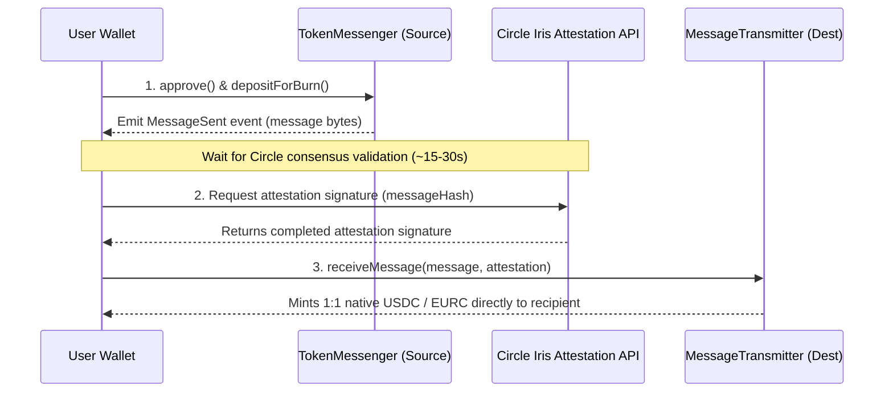

# Secure Transfer Bridge (Circle CCTP & Bridge Kit)

Cross-network fund mobility is essential for active workspaces and autonomous agents. Syn DAO integrates **Circle Bridge Kit** and direct Cross-Chain Transfer Protocol (CCTP) to support bidirectional, 1:1 transfers of stable digital dollars (**USDC**) and digital euros (**EURC**) between Arc (Mainnet & Testnet) and other major networks, without the risks of intermediary wrapping contracts or third-party liquidity pools.

***

## Bidirectional Transfer Flows

Syn DAO supports bridging in both directions:
1. **Deposit (IN)**: Bridge USDC or EURC from Ethereum, Base, or Avalanche onto Arc (Mainnet or Testnet) to fund a project workspace, deposit into the Treasury, or back active campaigns.
2. **Withdraw (OUT)**: Bridge USDC or EURC from Arc back to Ethereum, Base, or Avalanche to distribute assets to external participant vaults.

### How Direct Transfers Work Under the Hood

Cross-Chain Transfer Protocol (CCTP) is a native utility by Circle that enables secure burn-and-mint transfers of USDC and EURC across blockchains. Powered by **Circle Bridge Kit**, Syn DAO features:
- **Instant Pending Tracking**: Transfers are registered in local storage and tracked immediately upon burn submission.
- **USDC & EURC Asset Selector**: Seamlessly toggle between native USDC and EURC with instant balance checks and route validation.
- **CCTP Recovery Modal**: If an attestation wait is interrupted or a page reloaded, the built-in Recovery Modal enables users to paste their source transaction hash, fetch the Circle attestation proof, and trigger the mint on the destination chain without risk of lost funds.

#### The 4-Step Bridge Pipeline
1. **01 - Burn Token on Source**: Initiate burn of USDC or EURC on source chain (e.g., Ethereum or Arc).
2. **02 - Circle Consensus Attestation**: Poll Circle Iris API for consensus validation.
3. **03 - Attestation Signed & Received**: Cryptographic proof generated and returned by Circle.
4. **04 - Mint Token on Destination**: Submit message and attestation to complete mint on destination chain.

> 💡 **Try It Yourself:** Trigger a CCTP Transfer on the **Bridge** tab or run a rebalance on the **Agent** dashboard to see this pipeline execute live in real-time.

---

## Step-by-Step Guides

### 1. Depositing USDC / EURC (IN) to Arc
To bridge tokens from an external chain into Arc:
1. Navigate to the **Bridge** tab on the dashboard sidebar.
2. Select your active network mode (**Mainnet** or **Testnet**) in the header.
3. Choose your desired asset (**USDC** or **EURC**) using the asset selector.
4. Ensure the route is set to deposit into Arc.
5. Select your origin chain (e.g., *Ethereum*, *Base*, *Avalanche*).
6. Enter the amount you wish to deposit.
7. Click **Bridge Token to Arc**:
   - **Approve & Burn**: Sign transactions to authorize and burn origin tokens.
   - **Attestation**: Syn DAO tracks the transfer and queries Circle Iris for consensus proofs.
   - **Mint**: The app switches your wallet to Arc and mints 1:1 native tokens to your destination wallet.

> ⚠️ **Arc Gas Note When Bridging EURC:** Arc uses native USDC (18 decimals) as its network transaction gas token. When bridging EURC into Arc, ensure your Arc account maintains a small amount of native USDC (~0.01 USDC) to pay gas for executing subsequent transactions.

### 2. Withdrawing USDC / EURC (OUT) from Arc
To withdraw your token reserves back to an external chain:
1. Navigate to the **Bridge** tab.
2. Select your asset (**USDC** or **EURC**).
3. Switch the transfer direction (from Arc to external chain).
4. Select your target destination chain.
5. Enter the amount you wish to withdraw.
6. Click **Bridge Token**:
   - **Burn**: Submit the burn instruction on Arc.
   - **Attestation**: The app polls the Circle Iris API.
   - **Mint**: Switch to destination network and claim the minted native token.

### 3. Recovering a Stalled Bridge Transfer
If your connection was interrupted during the attestation or mint phase:
1. Open the **Bridge** tab and click **Claim / Recover Transfer**.
2. Paste the transaction hash from your source chain burn transaction.
3. The interface will fetch the message bytes, retrieve the signed attestation from Circle Iris, and prompt you to submit the `receiveMessage` mint transaction on the destination chain.

---

## High-Resilience Bridge Architecture

To eliminate RPC timeouts, browser CORS errors, and adblocker interference when querying cross-chain balances, Syn DAO implements a multi-tiered balance hydration pipeline:

### 1. Server-Side Balance Proxy (`/api/bridge/balance`)
- **Direct Edge Routing**: Proxies balance checks through Next.js server routes, protecting client IP privacy and completely bypassing browser adblockers or Cloudflare CORS restrictions.
- **In-Memory Caching (6-Second TTL)**: Prevents hammering public RPC providers when users rapidly toggle between chains or tokens.
- **Multi-Token Support**: Supports querying both USDC and EURC across all supported CCTP networks via `?token=USDC` or `?token=EURC`.
- **Dual Arc Balance Resolution**: On Arc chains, the route reads both ERC-20 `balanceOf` and native gas token balance, ensuring correct balance reporting whether funds are held in ERC-20 or native format.

### 2. Dual-Strategy Client Fallback
- **Strategy 1 (Primary)**: Queries the server `/api/bridge/balance` endpoint.
- **Strategy 2 (Fallback)**: If the server is unreachable, falls back to direct client-side on-chain reads using `viem` with redundant RPC arrays (`publicnode`, `drpc`, `1rpc`, `tenderly`).

### 3. Micro-Balance Precision & Real-Time Sync
- **Fractional Precision**: Displays micro-balances down to 4 decimal places for small amounts ($< 0.01$) so nanopayments and dust balances are clearly visible.
- **Window Focus & Event Revalidation**: Auto-refreshes balances whenever the browser tab regains focus, on a background 12-second polling cycle, or upon cross-app transaction events (`synarc_usdc_changed`, `synarc_eurc_changed`).

---

## Official CCTP Deployed Contracts

Syn DAO coordinates with the following verified Circle contract endpoints:

### Arc Mainnet — Production
* **Circle Mainnet Iris Attestation Endpoint**: `https://iris-api.circle.com/v1/attestations`

| Chain | Domain ID | TokenMessenger Address | MessageTransmitter Address | USDC Contract Address | EURC Contract Address |
| :--- | :---: | :--- | :--- | :--- | :--- |
| **Arc Mainnet** | `26` | `0x28b5a0e9C621a5BadaA536219b3a228C8168cf5d` | `0x81D40F21F12A8F0E3252Bccb954D722d4c464B64` | `0x3600000000000000000000000000000000000000` | `0xbEf5f6d51CB62b58e6A8f77868681825C6fe21c1` |
| **Ethereum** | `0` | `0x28b5a0e9C621a5BadaA536219b3a228C8168cf5d` | `0x81D40F21F12A8F0E3252Bccb954D722d4c464B64` | `0xA0b86991c6218b36c1d19D4a2e9Eb0cE3606eB48` | `0x1aBaEA1f7C830bD89Acc67eC4af516284b1bC33c` |
| **Base** | `6` | `0x28b5a0e9C621a5BadaA536219b3a228C8168cf5d` | `0x81D40F21F12A8F0E3252Bccb954D722d4c464B64` | `0x833589fCD6eDb6E08f4c7C32D4f71b54bdA02913` | `0x60a3E35Cc302bFA44Cb288Bc5a4F316Fdb1adb42` |
| **Avalanche** | `1` | `0x28b5a0e9C621a5BadaA536219b3a228C8168cf5d` | `0x81D40F21F12A8F0E3252Bccb954D722d4c464B64` | `0xB97EF9Ef8734C71904D8002F8b6Bc66Dd9c48a6E` | `0xC891EB4cbdEFf6e073e859e987815Ed1505c2ACD` |

### Arc Testnet — Sandbox
* **Circle Sandbox Iris Attestation Endpoint**: `https://iris-api-sandbox.circle.com/v1/attestations`

| Chain | Domain ID | TokenMessenger Address | MessageTransmitter Address | USDC Contract Address | EURC Contract Address |
| :--- | :---: | :--- | :--- | :--- | :--- |
| **Arc Testnet** | `26` | `0x8FE6B999Dc680CcFDD5Bf7EB0974218be2542DAA` | `0xE737e5cEBEEBa77EFE34D4aa090756590b1CE275` | `0x3600000000000000000000000000000000000000` | `0x89B50855Aa3bE2F677cD6303Cec089B5F319D72a` |
| **Ethereum Sepolia** | `0` | `0x8fe6b999dc680ccfdd5bf7eb0974218be2542daa` | `0xe737e5cebeeba77efe34d4aa090756590b1ce275` | `0x1c7d4b196cb0c7b01d743fbc6116a902379c7238` | `0x08210F9170F89Ab7658F0B5E3fF39b0E03C594D4` |
| **Base Sepolia** | `6` | `0x8fe6b999dc680ccfdd5bf7eb0974218be2542daa` | `0xe737e5cebeeba77efe34d4aa090756590b1ce275` | `0x036CbD53842c5426634e7929541eC2318f3dCF7e` | `0x808456652fdb597867f38412077A9182bf77359F` |
| **Avalanche Fuji** | `1` | `0x8fe6b999dc680ccfdd5bf7eb0974218be2542daa` | `0xe737e5cebeeba77efe34d4aa090756590b1ce275` | `0x5425890298aed601595a70AB815c96711a31Bc65` | `0x5E44db7996c682E92a960b65AC713a54AD815c6B` |

